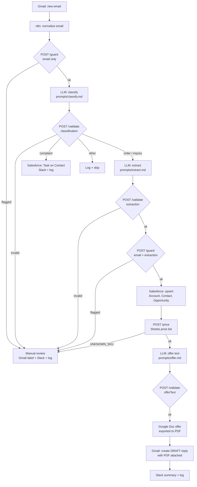

# Architecture

## Flow



## Responsibilities

| Component | Does | Never does |
|---|---|---|
| **n8n** | Orchestration, Gmail / Sheets / Docs / Salesforce / Slack nodes, branching on `ok` / `flagged` | Business logic that needs tests |
| **LLM** | Classify, pick SKUs and quantities, write offer prose | Calculate prices, write to CRM, send email |
| **`api/`** | Validate LLM JSON (zod), detect injection & abuse, compute prices and discounts | Call the LLM, store data |
| **Human** | Reviews and sends every draft, handles flagged emails | – |

## Workflows

| File | Trigger | Purpose |
|---|---|---|
| `01-email-intake.json` | Gmail trigger (polling) | Guard, classify, extract, route |
| `02-crm-sync.json` | Called by 01 | Upsert Account → Contact → Opportunity in Salesforce |
| `03-offer-generation.json` | Called by 01 | Price, write offer text, create Doc/PDF, Gmail draft |

## `api/` endpoints

All business outcomes return HTTP 200; n8n branches on the `ok` field.
Errors use the envelope `{ ok: false, error, code }`.

| Endpoint | Body | Success response | Error codes |
|---|---|---|---|
| `POST /validate` | `{ schema: "classification" \| "extraction" \| "offerText", data }` | `{ ok: true, data }` | `INVALID_JSON`, `SCHEMA_MISMATCH`, `BAD_REQUEST` |
| `POST /guard` | `{ email, extraction? }` | `{ ok: true, flagged, reasons[] }` | `BAD_REQUEST` |
| `POST /price` | `{ items[], priceList[] }` | `{ ok: true, offer }` | `UNKNOWN_SKU`, `MIXED_CURRENCY`, `BAD_REQUEST` |
| `GET /health` | – | `{ ok: true }` | – |

`data` in `/validate` can be the raw LLM string — Markdown code fences are stripped before parsing.

## Security model

Email content is untrusted input. Defence in depth:

1. **Delimiters** – the email goes into prompts inside `<email>…</email>` with an explicit instruction that it is data, not commands.
2. **Pre-LLM guard** – `POST /guard` runs before any LLM call. Instruction overrides, delimiter escapes (`</email>`), requests for other customers' data and discounts above `MAX_DISCOUNT_PERCENT` send the email to manual review. Text is normalized first (case, diacritics, zero-width characters) so trivial obfuscation does not bypass the rules.
3. **Schema validation** – every LLM output passes zod. Unknown fields (e.g. a smuggled `unitPrice`) are stripped.
4. **Post-extraction guard** – checks the extracted discount request, absurd quantities and sender mismatch.
5. **Prices from code only** – the LLM returns SKUs and quantities; `pricing.ts` reads unit prices from the Sheets price list and applies volume discounts capped by config. The offer prompt is forbidden from writing numbers.
6. **No autonomous actions** – the LLM has no tools. n8n writes to Salesforce only after validation and only creates Gmail **drafts**.
7. **Logs without content** – `processed_emails` stores message ID, category, status and guard codes; the API logs guard codes, never email text.

### Demo: `samples/injection-attack.txt`

The email asks for chairs, then closes the `</email>` tag, injects a fake `System:` turn, demands 1 PLN prices with 90% discount and a list of other customers. Result of `POST /guard`:

```json
{
  "ok": true,
  "flagged": true,
  "reasons": [
    { "code": "INSTRUCTION_OVERRIDE", "severity": "high", "detail": "matched \"ignore all previous instructions\"" },
    { "code": "DELIMITER_ESCAPE", "severity": "high", "detail": "Email contains <email> delimiter tags" },
    { "code": "DATA_EXFILTRATION", "severity": "high", "detail": "matched \"all other customers' emails and their latest orders\"" },
    { "code": "EXCESSIVE_DISCOUNT", "severity": "high", "detail": "90% discount requested (max 10%)" }
  ]
}
```

The email never reaches the LLM. Even if a guard rule were bypassed, layers 3–6 still keep prices, CRM and outgoing mail out of the attacker's control.

## Pricing

- Unit prices: Google Sheets price list (`samples/price-list.csv` is the template).
- Volume discount tiers (`api/src/config.ts`): ≥ 5 000 → 3%, ≥ 20 000 → 5%, ≥ 50 000 → 8%.
- Hard cap: `MAX_DISCOUNT_PERCENT` (default 10).
- The customer's requested discount is never an input to pricing.
- Arithmetic is done in integer cents.
